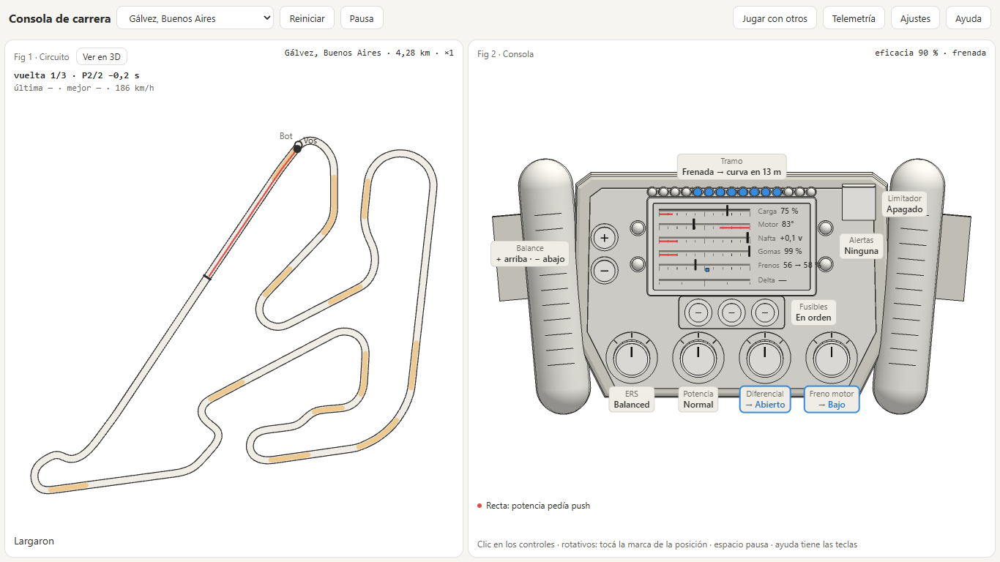
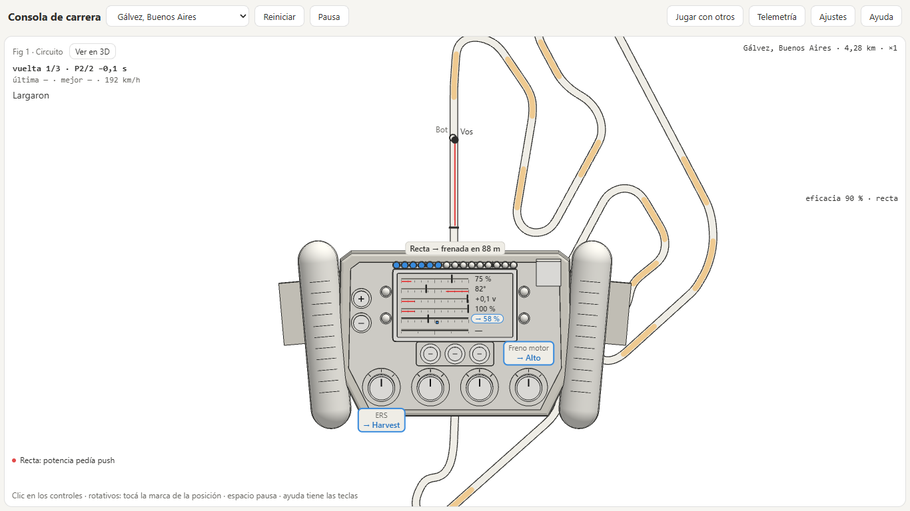
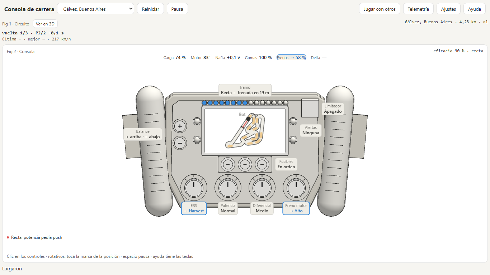
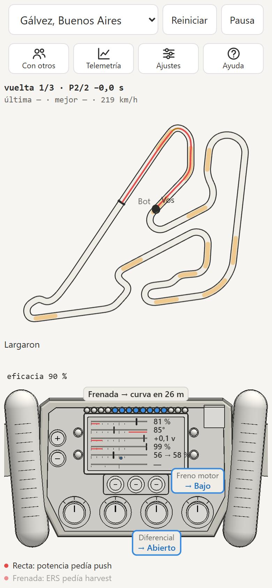
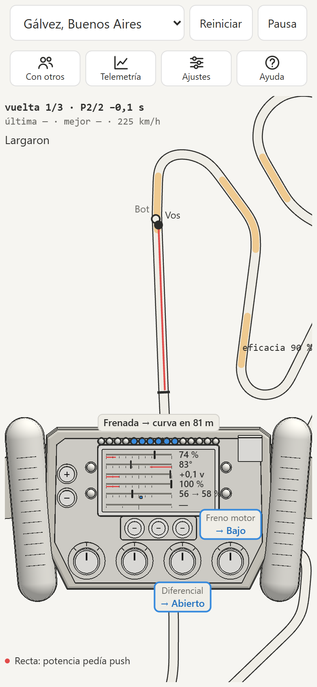
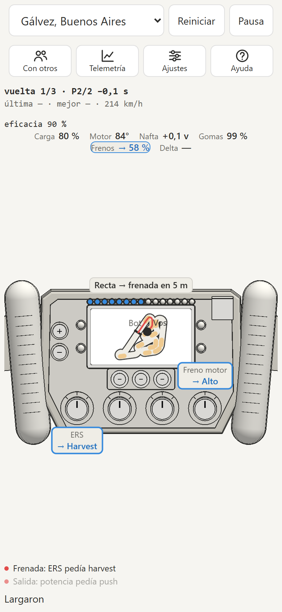

# Consola de carrera

Juego web de carreras contra un bot en circuitos reales. El auto se maneja solo: vos operás su computadora.
## Try it out at: https://agustindipolito.github.io/f1-console/

## Cómo se ve

Tres distribuciones de pantalla, a elegir en Ajustes. Abajo del volante, un renglón por tramo dice qué salió bien o qué control pedía otra cosa.

**Automática:** el mapa del circuito al lado de la consola.

**Volante delante del mapa:** el mapa sigue a tu auto con el sentido de marcha hacia arriba y el volante tapa la parte de abajo, como desde el asiento.

**Mapa en el volante:** el circuito va en la pantalla del volante y las lecturas de la pantalla pasan a un renglón arriba.

En el teléfono la pantalla de juego entra entera, sin desplazar:

  
  
  

## Arrancar

Requiere Node 20 o superior.

    npm install
    npm run tracks   # baja los trazados a public/tracks (una sola vez)
    npm run dev

Otros comandos: `npm test` (tests de la simulación), `npm run calibrate` (carreras en los 40 circuitos contra jugadores modelo para revisar el balance de los bots) y `npm run typecheck`.

Abrir `index.html` con doble clic no funciona: la página carga TypeScript y necesita el servidor de Vite. Para jugar sin servidor, compilá con `npm run build` y abrí `dist/index.html`. Ese archivo trae todo adentro y baja los trazados del CDN, así que pide conexión.

Para publicarlo en un servidor, compilá con `npm run build:web` y subí `dist-web/`. La primera carga es más liviana: three, la pista 3D, la sala y los diálogos llegan aparte, cuando hacen falta.

Esa versión se instala como aplicación en el teléfono (en Android desde el aviso del navegador o desde Ajustes; en el iPhone, desde Compartir con «Agregar a inicio») y abre sin conexión: la primera visita guarda la página y los 40 trazados. Tiene que servirse por HTTPS. Para revisar cómo se ve en teléfono, tableta y computadora: `npm run check:mobile` después de compilar.

## Publicar en GitHub Pages

Cada push a `main` corre el typecheck y los tests, compila con `npm run build:web` y publica `dist-web/` (`.github/workflows/pages.yml`). Si algo falla, queda la versión anterior. La primera vez hay que elegir en el repo **Settings → Pages → Source: GitHub Actions**. La página queda en `https://<usuario>.github.io/<repo>/`, con HTTPS, así que se instala y abre sin conexión.

## Seguir con Claude Code

Abrí la carpeta en una terminal y ejecutá `claude`. El contexto, las reglas y el backlog están en `CLAUDE.md`.

## Créditos

Trazados de [bacinger/f1-circuits](https://github.com/bacinger/f1-circuits) (MIT). Datos no oficiales, sin relación con Formula One Licensing B.V.
